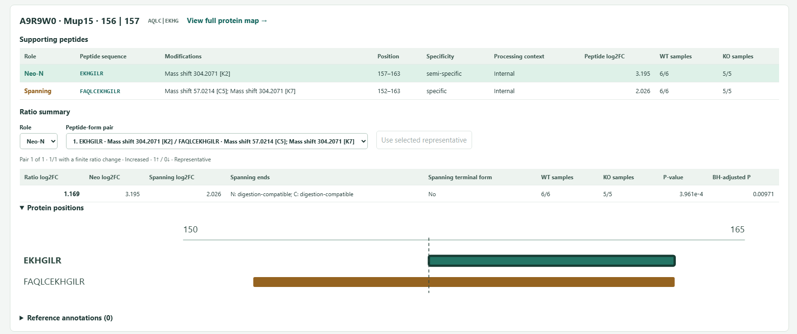

# Atelente

**Quantitative analysis of proteolytic cleavage using neo-terminal and spanning peptides.**

Atelente is an R package with a local Shiny interface. It finds neo-N and neo-C peptides, matches them to observed peptides spanning the same cleavage bond, and calculates neo/spanning ratios. Replicated conditions can be compared using limma with Benjamini–Hochberg correction. Results are presented in an interactive HTML report and Excel tables, with optional MEROPS and UniProt annotations.

[Installation](#installation) · [Usage at a glance](#usage-at-a-glance) · [Example datasets](#example-datasets) · [Results](#results) · [Citation](#citation)

## Installation

Use R 4.3 or later. Install Atelente and the packages used by the interface and Excel input/output:

```r
install.packages(c("remotes", "shiny", "readxl", "openxlsx"))
remotes::install_github("enverozturk/atelente", dependencies = NA)
```

For statistical testing:

```r
install.packages("BiocManager")
BiocManager::install("limma", ask = FALSE, update = FALSE)
```

While this repository is private, installation requires an account with repository access.

## Usage at a glance

Open the interface:

```r
shiny::runApp(atelente::pm_wizard_app())
```

1. **Files:** select a peptide table (CSV, TSV or XLSX) and a FASTA file.
2. **Columns:** select peptide sequences, protein accessions, quantities and, when available, modifications.
3. **Samples:** assign samples to conditions and set the comparison, digestion rule and labeling options.
4. **Review & run:** review the settings, choose the output directory and run.

Quantities can be linear or log2. Leave missing measurements empty. For statistical testing, samples must represent independent experimental units; summarize technical replicates before import.

With annotations enabled, the first run downloads reference records and later runs reuse the local cache. UniProt requests contain protein accession identifiers. Peptide tables and sample quantities are processed locally.

## Example datasets

The three manuscript datasets provide complete worked inputs. Download the repository using **Code → Download ZIP**, extract it, and run the commands below from its top-level directory after installing Atelente.

| Dataset | Application | Files and settings |
| --- | --- | --- |
| GluC time course, PXD000503 | Complementary neo-N and neo-C products with a peptide spanning the same bond | [GluC](manuscript/01_GluC_PXD000503) |
| Mouse kidney, MSV000094661 | Neo/spanning comparisons in the PKD dataset used by TermineR | [Kidney](manuscript/02_Kidney_MSV000094661) |
| Aortic valve, PXD073246 | Severe versus Control in non-enriched data | [Aortic valve](manuscript/03_Aortic_PXD073246) |

Start with the GluC dataset:

```sh
Rscript manuscript/run.R 01_GluC_PXD000503
```

The runner unpacks the peptide CSV, checks the peptide and FASTA hashes, and passes the saved configuration to Atelente. Open `manuscript/01_GluC_PXD000503/results/report.html` when it finishes. Instructions for all three datasets, preparation details and result counts are in [Manuscript analyses](manuscript/README.md).

## Results

Select a result to inspect the neo-terminal and spanning peptides, their positions, sample measurements and alternative pairs.



| Output | Contents |
| --- | --- |
| `report.html` | Searchable results, peptide details, protein maps and reference annotations |
| `atelente_results.xlsx` | Results, Peptides and Settings worksheets |
| `atelente_audit.zip` | Detailed measurements, alternative pairs, mappings and provenance |
| `run_manifest.json` | Run settings, reference versions and file hashes |

The ratio log2 fold change is the treatment-minus-control difference in mean sample log2(neo/spanning). The neo and spanning fold changes shown with a pair use the same common samples. A fixed rule selects a representative pair; alternative pairs remain available. `Spanning ends` describes the spanning peptide's own termini, while that peptide still crosses the selected bond.

Keep the output files together and open the HTML report in Chrome or Edge. The finished report works offline. The interface saves runs under `atelente_runs/<run>/results/` by default; the manuscript examples save them beside their inputs.

## Documentation

- [Usage](docs/USAGE.md): input preparation, interface, report views and scripted runs.
- [Analysis](docs/ANALYSIS_RULES.md): candidate bonds, representative selection, ratios and tests.
- [Reference annotations](docs/REFERENCE_ANNOTATIONS.md): MEROPS, UniProt and offline snapshots.
- [Manuscript analyses](manuscript/README.md): prepared inputs and settings for the three datasets.

The separate peptide/protein functions are described in [Peptide/protein workflows](docs/PEPTIDE_PROTEIN_WORKFLOW.md). Source functions are in `R/`, help pages in `man/`, command-line entry points in `scripts/`, and regression checks in `tests/`.

## Citation

**Enver Ozturk. Atelente: A Tool for Quantitative Analysis of Proteolytic Cleavage Using Neo-Terminal and Spanning Peptides.** Software version 0.1.0.

Use [CITATION.cff](CITATION.cff) for software citation metadata and record the version or commit used in an analysis. The manuscript inputs identify the analysis commit and reference versions.

## License and contact

Atelente is licensed under [GPL-3.0](LICENSE.md). The prepared study inputs retain their source attribution; see [Manuscript analyses](manuscript/README.md).

Enver Ozturk · [ORCID](https://orcid.org/0009-0004-8359-8032) · [enver.ozturk@metu.edu.tr](mailto:enver.ozturk@metu.edu.tr)
